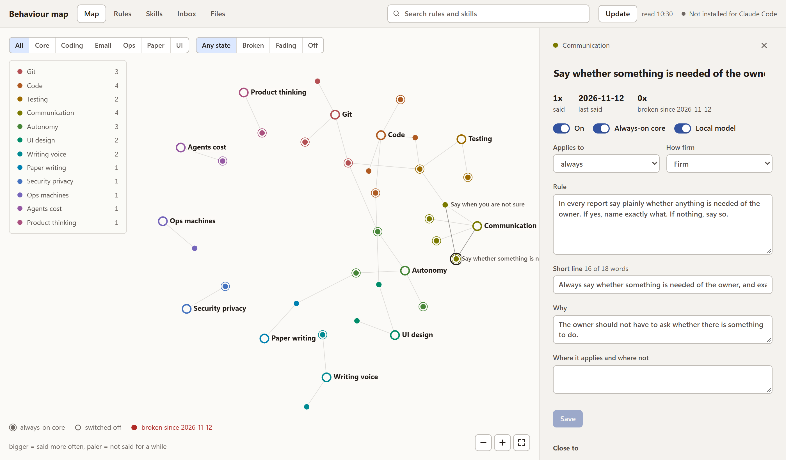

# Behaviour map

Your working rules for AI assistants, written down once.

Every new session starts from zero, so you repeat yourself: no AI byline on commits, answer first, do not ask
before every push. A behaviour map keeps each of those as one small rule file with your reason and your own words,
and builds from them the instruction file each tool reads: `CLAUDE.md` for Claude Code, `AGENTS.md` for Codex and
OpenCode, custom instructions for ChatGPT, a system prompt for a local model. A local page lets you look at the
rules, change them, and see which ones your assistants keep breaking.

Everything runs on your computer. Python 3.9 or later, no packages to install.



## Start

```
git clone https://github.com/mos-ks/behavior-map
cd behavior-map
```

Then double-click `brain.cmd` (Windows) or run `./brain.sh` (macOS, Linux). The page opens in your browser and runs
in the background, without a window. It stops by itself when you close its tab. `python ui.py` does the same in a
terminal, if you prefer to see its output.

The first start opens on **Build my map**. Press it, and a model reads everything you typed to Claude Code on this
computer and writes:

- the rules, each with your own sentences as evidence and how often you said it
- the short core that every session starts with
- a suggested skill for each job you asked for again and again (release the app, review a pull request)
- the instruction files for each tool, ready to switch on

You need no API key if Claude Code is installed and signed in: the build asks it, under the login it already has,
the same way you use it. To use another model instead, pick **A local or hosted model** and enter an
OpenAI-compatible address (vLLM, Ollama, llama.cpp, or a hosted service). Your prompts go to the model you pick and
nowhere else. Private details such as web addresses, IP addresses and key-like strings are blanked before the
model sees them.

A few months of chats take a few minutes. What was read is kept, so a stopped build starts where it stopped, and a
later build only asks about what is new.

| Then | How |
|---|---|
| Check the rules | Map and Rules tabs. Change any rule, switch it off, or move it in or out of the core |
| Install for Claude Code | The switch in the result, in the Files tab, or `python build.py --install`. It goes into `~/.claude/CLAUDE.md`; every later save keeps it current |
| Install for Codex or OpenCode | The switches in the Files tab, or `python build.py --install codex` (`opencode`, `all`) |
| ChatGPT, a local model | The Files tab has a copy button for each text |

Installing never throws away a file you wrote. If the tool's instructions file already has text of yours, the rules go
below it between two marks, and the file as it was is saved beside it once (`CLAUDE.md.before-behaviour-map`). Later
saves rewrite only the part between the marks. Switching it off, or `python build.py --uninstall all`, takes that
part out again and leaves your text.

## How the build reads your chats

1. `learn.py` collects every prompt you typed in Claude Code (not what the assistant wrote), with private details
   blanked.
2. The model reads them in parts and names the standing instructions and the repeated jobs, each with the numbers
   of the prompts that show it. A finding without a prompt behind it is dropped.
3. The model puts what says the same thing together. When you changed your mind, the later statement wins and
   the rule says what it replaced. When you said both and it is unclear which holds, the more cautious side is
   the rule for now and the question is marked in the Rules tab (filter: Open question).
4. A starter rule you said yourself is rewritten in your words. A starter rule you never said stays, and the
   result says how many; switch them off if they do not fit.
5. The build checks everything as `python build.py` would, and leaves out what it would refuse.

Without the page: `python bootstrap.py` (or `--engine claude` / `--engine api`). To have an assistant do it by
hand and talk you through each rule, open this folder in Claude Code and say **"Follow BOOTSTRAP.md"**.

## The page

| Tab | What it shows |
|---|---|
| Map | Every rule as a dot, grouped by category, linked to the rules closest to it. Bigger: said more often. Paler: not said for a while. Ring: in the always-on core. Red: broken since you installed the map |
| Rules | The same as a table, with search, filters and an editor. A change is checked before it is written |
| Skills | Every skill on this computer: where it is active, how often an assistant loaded it, in which projects. Skills you wrote yourself and skills suggested from your chats can be switched on for every project |
| Inbox | Your corrections from new chats, to count on a rule, turn into a new rule, or drop |
| Files | What each tool is given, where the file is written, and whether anything reads it. Install switches for Claude Code, Codex and OpenCode, copy buttons for the rest |
| Build | Build the map from all your chats, or again later |

**Update** in the top bar reads your new chats and rebuilds what changed.

## A rule file

```
---
id: git-no-ai-attribution
title: "No AI attribution anywhere"
category: git
scope: always          # always | coding | ui | paper | email | ops | project:<name>
strength: hard         # hard | soft
enabled: true
times_seen: 16
sources: [chats]
last_seen: 2026-10-12
needs_owner: false     # true: an open question in conflicts.md touches this rule
short: "Never add AI attribution: no Co-Authored-By trailer, no AI byline anywhere."
---

**Rule.** What the assistant must do.

**Why.** Your reason.

**In the owner's words**
- 2026-10-12, shop: "why is there a co-author line again"
```

The rules listed in `profiles/core.yaml` form the short core every session starts with (at most 70 lines).
The rest is grouped into task files (coding, UI, papers, email, machines) that the core names, so an assistant
reads them only before that kind of work. A rule with scope `project:<name>` goes into `exports/project-<name>.md`
and nowhere else; add a line to that project's own `CLAUDE.md` telling the assistant to read it.

## How the map learns

Claude Code keeps every session as a file under `~/.claude/projects` (or under `CLAUDE_CONFIG_DIR` when you set that). Update reads what was added since last
time and keeps the short prompts in which you say how to work ("dont", "never", "i said", "again").

- A correction that clearly matches a rule is counted on it. If that rule was on, it also counts as **broken**:
  the assistant had the rule and still needed telling.
- A weaker match waits in the Inbox with a suggestion.
- The same thing said three times on two days is offered as a new rule.
- A rule not said for 90 days shows as fading. Nothing is switched off for you.

Matching is by shared words, so on its own it is rough. **With a model address** it gets much better: when one is
saved in the Build tab (it goes to `map/signals/judge.json`, which is never committed) or OpenCode is set up with
an OpenAI-compatible address, Update asks that model for each correction whether it is a standing instruction or
just talk about the task at hand, which rule it belongs to, and how a new rule should read. When the model does not
answer, everything works as above. Update calls no model you did not set up.

## Your map stays yours

This repository holds the program and the starter rules. Your map is in `map/`, which the repository ignores:
your rules quote you, and the Inbox holds things you typed.

To keep its history, make `map/` its own **private** git repository (`git init` inside it, then add a private
remote). Update then commits and pushes it, after a secret scan with gitleaks (needs Docker). Without Docker, or
when the scan finds something, the change is committed locally and not pushed.

## More than one computer

The private repo also keeps the map the same on every computer you work on. Each computer reads its own chats
and pushes what it learned; the others take it in on their next pull.

On the second computer:

```
git clone https://github.com/mos-ks/behavior-map.git
git clone <your private map repo> behavior-map/map
cd behavior-map && python3 build.py --install
```

The page pulls when it starts and before every Update. A computer without a browser (a server you reach over
ssh) runs the same steps from cron instead:

```
*/30 * * * * cd ~/behavior-map && python3 sync.py --update >> map/_work/sync.log 2>&1
```

`--update` pulls, reads that computer's new chats, rebuilds, refreshes the installed copies and pushes.
`--follow` only pulls and rebuilds, for a computer whose chats should not count.

Clashes settle themselves where they can. The generated files are written again from the merged rules. A rule
changed on two computers merges field by field: counts add up, quotes from both stay, and a wording edit on one
side and a new quote on the other both survive. The Inbox merges by correction, and a decision beats an open
entry. Only the same field edited differently on both computers stops the pull: nothing is lost, the page names
the file, and the next Update goes through once you have kept one version.

Optional `map/settings.json`:

```
{"project_folders": ["D:/work"], "own_skills": "D:/my-skills"}
```

`project_folders` are folders whose subfolders are your projects (the default is `~/Documents`, `~/Projects`,
`~/code` and similar). `own_skills` is a folder of skills you write; they appear in the Skills tab with a switch.

## Commands

| Command | What it does |
|---|---|
| `python ui.py` | The page, in this terminal (Ctrl+C stops it). `--background` runs it without a window until its tab is closed (what `brain.cmd` and `brain.sh` do); `--no-open` starts it without opening the browser |
| `python bootstrap.py` | Build the map from your chats without the page. `engines` says which engines are ready |
| `python build.py` | Check the rules and write the generated files. `--check` only checks, `--install [claude, codex, opencode, all]` also installs, `--uninstall [...]` takes it out again |
| `python sync.py` | Save the map to its repo: commit, pull, secret scan, push. `--follow` only pulls and rebuilds, `--update` is the whole Update button without the page |
| `python learn.py scan` | Read new chats for corrections, without the page |
| `python learn.py prompts` | Write everything you typed to `map/_work/prompts.jsonl` (used by BOOTSTRAP.md) |
| `python skills.py` | Print the skill library |
| `python -m unittest test_build test_learn_ui test_bootstrap` | The tests. They run on the starter rules, never on your map, and call no model |

The map can live somewhere else: set the environment variable `BEHAVIOR_MAP_DIR` to its folder.

## Limits

- Corrections, skill use and the build read Claude Code sessions on this computer only. Other computers add
  theirs through the shared repo (see More than one computer).
- The build is as good as the model that reads. A small local model finds fewer rules and words them less well
  than Claude; check the result in the Rules tab either way.
- The build reads chats in any language the model knows and writes the rules in English, with your own words
  kept as quotes. The daily corrections scan, which uses no model, knows English and German correction words;
  a German correction lands in the Inbox rather than on a rule unless a local model is set up to place it.
- The categories and scopes are fixed in `build.py`.
- The page is for one person on one machine. It listens on 127.0.0.1 and takes changes only from its own tab.

## Licence

Copyright (c) 2026 Dr. Moussa Kassem Sbeyti. MIT licence, see [LICENSE](LICENSE).

You may use, copy, change and republish this, also in your own products. The one condition: the copyright line and
the licence text stay in every copy and in anything built from a substantial part of it.
